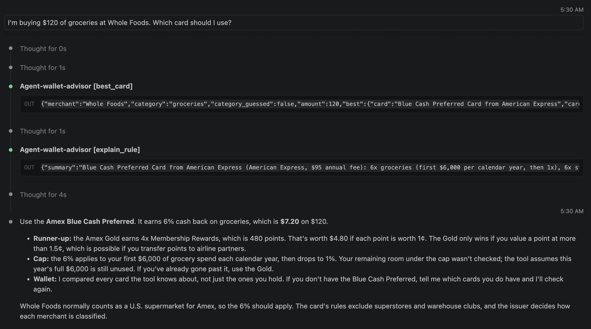

# agent-wallet-advisor

An [MCP](https://modelcontextprotocol.io) server that an AI shopping agent calls **before it pays**, to choose which of the user's credit cards earns the most rewards for that purchase.



```
Agent: "Buying $120 of groceries at Whole Foods. Which card?"
  -> best_card(merchant="Whole Foods", category="groceries", amount=120)
  <- Blue Cash Preferred: $7.20 back (6% groceries). Runner-up: Amex Gold, $4.80.
     Amex Gold would win if you value Membership Rewards points above 1.50¢.
```

## Why this matters

Agentic commerce means the agent, not the person, will increasingly fill in the payment method at checkout. People already juggle "use this card for groceries, that one for dining" in their heads. An agent can't do that unless the reward rules are **machine-readable** and exposed as a tool it can call.

This project is a small, inspectable version of that layer:

- reward rules as structured data with provenance (`as_of`, `source_url`, `source_note`, `needs_verification`)
- deterministic reward math that can be unit-tested
- the subjective input (what a point is worth) is an explicit, user-owned setting, not a hidden constant
- an MCP interface with typed, structured output that any MCP-capable agent can use

## Quick start

Requires [uv](https://docs.astral.sh/uv/). uv fetches Python 3.12 if you don't have it.

```bash
git clone https://github.com/vdelengov/agent-wallet-advisor
cd agent-wallet-advisor
uv sync
uv run pytest
```

To try it without cloning:

```bash
uvx --from git+https://github.com/vdelengov/agent-wallet-advisor agent-wallet-advisor
```

The server speaks MCP over stdio, so it waits silently for a client. Connect it to one of the clients below.

### Test with the MCP Inspector

Requires Node.js (for `npx`).

```bash
# Web UI: opens a browser; click Connect, then Tools -> best_card
npx @modelcontextprotocol/inspector uv run agent-wallet-advisor

# Or headless, straight from the terminal
npx @modelcontextprotocol/inspector --cli uv run agent-wallet-advisor \
  --method tools/call --tool-name best_card \
  --tool-arg merchant="Whole Foods" --tool-arg category=groceries --tool-arg amount=120
```

### Use it from Claude Code

This repo includes a project-scoped [`.mcp.json`](.mcp.json), so opening the folder in Claude Code (CLI or VS Code) finds the server. Approve it when prompted, or check with `/mcp`.

To register it yourself from any directory instead, optionally with your own point values:

```bash
claude mcp add agent-wallet-advisor \
  -e AGENT_WALLET_POINT_VALUES='{"amex_membership_rewards": 1.8}' \
  -- uvx --from git+https://github.com/vdelengov/agent-wallet-advisor agent-wallet-advisor
```

Then ask:

> I'm buying $120 of groceries at Whole Foods, which card?

Claude calls `best_card` and answers with the card, the dollar estimate, the runner-up, and where the ranking would flip.

## Tools

| Tool | Input | Returns |
|---|---|---|
| `best_card` | `merchant`, `category`, `amount`, optional `wallet` (card names), optional `point_values`, optional `stale_after_days`, optional `ending_soon_days` | best card, $ estimate, runner-up (each with the `rule` that set its rate and its data freshness), one-line explanation, point values used, notes, `ending_soon` rules, `warning` |
| `list_cards` | none | each card's issuer, fee, base rate, points program and bonus categories |
| `explain_rule` | `card` (name, id, or alias such as "amex gold"), optional `stale_after_days`, optional `ending_soon_days` | full rules, caps, points program and its valuation basis, what isn't modeled, source, data freshness, and `rules`: every rule with its dates and status (`active`, `ending_soon`, `upcoming`, `expired`) |

Categories: `dining`, `groceries`, `travel`, `gas`, `online_shopping`, `streaming`, `drugstores`, `entertainment`, `transit`, `other`. Common aliases such as "restaurants", "supermarket" and "pharmacy" are accepted. If the category is unknown, the server **guesses from the merchant name** and says so in `notes`.

## Point values are a setting, not a constant

A point is worth whatever you redeem it for. Cash back is face value, but points depend on how you redeem them. Amex Membership Rewards points might be worth under 1¢ as a statement credit, and many people value them at 1.5–2¢ because of airline transfers. **That assumption decides the ranking.** At 1¢, Blue Cash Preferred wins the Whole Foods example. At 2¢, Amex Gold wins.

So the server treats it as the user's choice:

| Layer | How | Example |
|---|---|---|
| Default | `point_programs` in `cards.json`: 1.0¢ for every program, with a `basis` note explaining why | |
| Per user (server) | `AGENT_WALLET_POINT_VALUES` env var (JSON) | `{"amex_membership_rewards": 1.8}` |
| Per call | `point_values` argument to `best_card` | `{"amex_membership_rewards": 2.0}` |

Keys: `chase_ultimate_rewards`, `amex_membership_rewards`, `citi_thankyou`. Cash back can't be overridden. Each result:

- reports the `point_values_used`
- adds a **break-even** note when a point value decides the winner ("Amex Gold would win if Membership Rewards points were worth more than 1.50¢")
- breaks exact ties in favor of cash back, which needs no valuation

One subtlety: a value is set per program, not per card. Valuing Ultimate Rewards at 1.5¢ also raises Freedom Unlimited, which is only fair if you hold a Sapphire card to transfer through.

### Example: same purchase, user values Amex points at 2¢

```json
{"merchant": "Whole Foods", "category": "groceries", "amount": 120, "point_values": {"amex_membership_rewards": 2.0}}
```

```json
{
  "merchant": "Whole Foods",
  "category": "groceries",
  "category_guessed": false,
  "amount": 120.0,
  "best":      {"card": "American Express Gold Card", "card_id": "amex-gold", "rate": 4.0, "reward_usd": 9.6,
                "cap_applied": false, "points_program": "amex_membership_rewards", "points": 480.0, "cents_per_point": 2.0,
                "data_as_of": "2026-11-24", "data_age_days": 0, "stale": false, "stale_reason": null,
                "rule": {"kind": "category", "category": "groceries", "rate": 4.0,
                         "valid_from": null, "valid_until": null, "description": null}},
  "runner_up": {"card": "Blue Cash Preferred Card from American Express", "card_id": "amex-blue-cash-preferred", "rate": 6.0,
                "reward_usd": 7.2, "cap_applied": false, "points_program": "cash", "points": null, "cents_per_point": null,
                "data_as_of": "2026-11-24", "data_age_days": 0, "stale": false, "stale_reason": null,
                "rule": {"kind": "category", "category": "groceries", "rate": 6.0,
                         "valid_from": null, "valid_until": null, "description": null}},
  "explanation": "American Express Gold Card earns 4x points on groceries (valued at 2¢ each) -> $9.60 on $120.00; next best is Blue Cash Preferred Card from American Express at $7.20.",
  "point_values_used": {"amex_membership_rewards": 2.0, "chase_ultimate_rewards": 1.0, "citi_thankyou": 1.0},
  "notes": [
    "American Express Gold Card stays ahead only while American Express Membership Rewards points are worth more than 1.50¢ (assumed 2¢). Pass point_values to use your own.",
    "Assumes no prior spend toward caps this period. Estimates only, not financial advice."
  ],
  "stale_after_days": 90,
  "warning": null,
  "ending_soon_days": 30,
  "ending_soon": []
}
```

When the rule behind the best or runner-up card ends within `ending_soon_days`, it's listed and repeated in `warning`:

```json
"ending_soon": [{"card": "American Express Gold Card", "card_id": "amex-gold",
                 "rule": "10x groceries promotion (…)", "valid_until": "2026-12-31", "days_left": 20}]
```

Errors such as an empty wallet, unknown cards only, a non-positive amount, or an invalid point value come back as MCP tool errors with a readable message, so the agent can fix the call.

## How the math works

```
reward_usd = amount × rate × cents_per_point / 100
```

- `rate` comes from the first rule that applies on the purchase date: an active promotion, then the category multiplier, then the base rate (see [Dated rules and promotions](#dated-rules-and-promotions)).
- **Caps:** only the spend left under the cap earns the bonus rate, and the rest earns `rate_after`. A large purchase can flip the winner: on a $20,000 grocery run, Amex Gold beats Blue Cash Preferred because BCP's 6% stops at $6,000.
- **Ties** go to cash back, then to card name, so results are deterministic.

## Design decisions

- **Every card is checked against the issuer's page and records `as_of` and `source_url`.**
- **Point values are configurable, and the break-even is shown.** What a point is worth is the user's call, and it often decides the winner. So it's a setting (data default, env var, per call), and each result says the value at which the ranking would flip.
- **Ties go to cash back.** When two cards earn the same, the cash-back card wins, because its value doesn't depend on a valuation assumption.
- **Promotions are modeled as dated rules, not ignored.** An offer with a published end date applies only while it's active, the result says when it ends soon, and the card falls back to its standing rate afterwards.
- **Issuer-specific merchant coding isn't modeled.** Each merchant maps to one category for all cards, even though issuers decide for themselves what counts as a supermarket. This keeps the model simple and explainable. The known gaps are listed under [Limitations](#limitations).

## Data and sources

7 cards: Chase Sapphire Preferred, Chase Freedom Unlimited, American Express Gold, Amex Blue Cash Preferred, Citi Double Cash, Capital One Savor and Wells Fargo Active Cash. Each was checked against the issuer's product page on 2026-11-24, and `source_url` records the page.

Blue Cash Preferred source: American Express product page, as of 2026-11-24. No card is currently flagged `needs_verification`. A data-validation test checks every card's fields, rates, categories, dates and sources.

### Dated rules and promotions

Every category rule has `valid_from` and `valid_until` (ISO dates, inclusive). `null` means no known start or end, which is what the standing earn rates use. Time-limited offers go in a card's `promotions` list as dated rules with their own `source_url` and `as_of`, but only when the issuer's own page shows the terms and the end date. Anything else, including merchant-specific offers such as "5x on Lyft", stays in `not_modeled`. No promotions qualify today, so the list is empty for every card.

For each purchase, a card's rate comes from the first rule that applies on that date:

1. an active promotion for the category, then
2. the standing category rule, then
3. the base rate.

- **Expired** rules (past `valid_until`) and **upcoming** rules (before `valid_from`) are skipped automatically, so the card falls back to the next rule. Each result shows which one applied in `rule`.
- **Ending soon**: if the rule behind the best or runner-up card ends within `ending_soon_days`, the result lists it under `ending_soon` (card, rule, `valid_until`, `days_left`) and in `warning`. The window is 30 days by default, set per server with `AGENT_WALLET_ENDING_SOON_DAYS` or per call with `ending_soon_days`; the per-call value wins.
- `explain_rule` lists every rule with its dates and a status: `active`, `ending_soon`, `upcoming` or `expired`.

### Data freshness

Issuers change terms, so results say how old the data is. `best_card` reports `data_as_of`, `data_age_days`, `stale` and `stale_reason` for the best and runner-up cards, and `explain_rule` reports them for the card asked about. A rule goes stale at whichever comes first:

- its `valid_until` has passed (`stale_reason: "valid_until"`): the data describes an offer that has ended, so the issuer page may show something new;
- it's older than `stale_after_days` since its `as_of` (`stale_reason: "age"`).

`stale_after_days` is 90 by default, set per server with the `AGENT_WALLET_STALE_AFTER_DAYS` env var, or per call with the `stale_after_days` argument. When a recommended card is stale, the result has a top-level `warning` naming the card, the reason and the `source_url` to check, so the agent can tell the user or verify before paying.

## Project layout

```
src/agent_wallet_advisor/
  data/cards.json   reward rules + point programs (bundled in the package)
  rewards.py        pure logic: lookup, category guessing, point values, reward math (no MCP imports)
  server.py         MCP tools: thin wrappers over rewards.py
tests/
  test_rewards.py   math, caps, point values, wallet and category edge cases
  test_data.py      schema checks on cards.json
  test_server.py    end-to-end over MCP with the SDK's in-process client
```

## Limitations

- **Static, hand-entered data.** It was checked against issuer pages on the `as_of` date, but issuers change terms. Nothing is pulled live; results flag data older than `stale_after_days` (see [Data freshness](#data-freshness)).
- **Not financial advice.** These are estimates for a demo.
- **Simplified rules.** Portal-only bonuses (for example "5x via Chase Travel"), merchant exclusions (superstores, warehouse clubs), U.S.-only conditions, "select streaming services" lists, and promotions that are merchant-specific or have no end date on the issuer's page are listed under `not_modeled` per card, not computed.
- **Caps assume zero prior spend.** The tool doesn't know your year-to-date spending. The math supports it (`spent_so_far`), but the MCP tool doesn't expose it yet.
- **Merchant to category is a small lookup table.** Real merchant category codes (MCCs) are what actually decide the category.
- **Issuer-specific merchant coding isn't modeled.** Each issuer decides what counts as its category. For example, Amex's "U.S. supermarkets" excludes superstores and warehouse clubs such as Walmart, Target and Costco. The merchant map uses one shared category per merchant for all cards (those three map to `other`), so a card whose issuer codes a merchant differently can be scored wrong.
- No real card numbers, bank connections, or account data, by design.

## Roadmap

1. **More cards**, plus rotating quarterly categories (Chase Freedom Flex, Discover it).
2. **Live offers**: card-linked offers (Amex Offers, Chase Offers) and merchant-specific promotions on top of base rewards.
3. **Checkout-flow demo**: an agent completes a purchase in a sandbox/test checkout (for example Stripe test mode or an agentic-commerce protocol), calling `best_card` before choosing the payment method.
4. Year-to-date spend tracking so caps are accurate across purchases.
5. Annual-fee-aware recommendations ("which card should I *get*?").
6. **Agent-side verification via `source_url` when stale**: when the data is past `stale_after_days`, the agent checks the issuer page before trusting the recommendation.
7. **Scheduled refresh job** that re-checks issuer pages and opens a PR with any changes for human review.
8. Quarterly check of the CFPB credit card agreement database to flag fee and pricing changes (covers terms and fees, not reward rates).

Built with [Claude Code](https://claude.com/claude-code).

## License

MIT. See [LICENSE](LICENSE).
